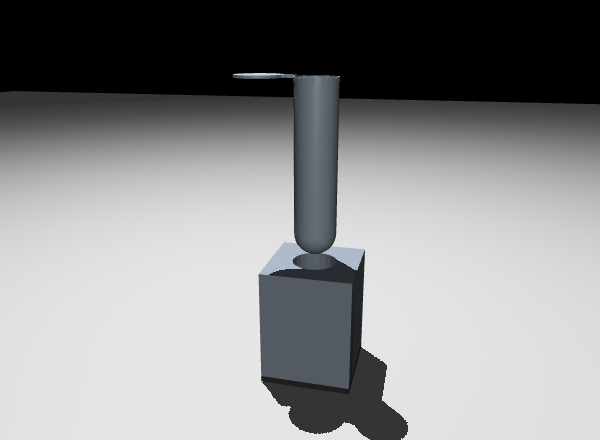

# lab_insert

用 MuJoCo 验证 FR3 的局部插入。固定随机种子可以复现同一组零件尺寸、孔隙、摩擦和质量。当前里程碑是几何验收与已对准的接触基线；性能数字只描述仿真。

## 安装与运行

使用 Python 3.11，从仓库根目录执行。以下为 Windows PowerShell：

```powershell
python -m venv .venv
.venv/Scripts/python -m pip install -e .
.venv/Scripts/python -m lab_insert.drop_test --n 100 --seed 0
.venv/Scripts/python -m lab_insert.baseline --family cuvette --seed 0
.venv/Scripts/python -m unittest discover -s tests -v
```

Linux/macOS 把解释器路径换为 `.venv/bin/python`。安装需要连通 PyPI 和 GitHub，mjfit 通过 pip 从固定的上游提交安装。

## 文件与验收

| 文件 | 用法 |
| --- | --- |
| lab_insert/labware_family.py | `sample(family, rng)` 产生 SI 参数，`to_mjcf(params)` 返回可独立编译的 MJCF。可选 cuvette、microtube、pcr。 |
| lab_insert/drop_test.py | 每个几何做三次独立重力实验：对中、侧偏半个单侧间隙、每侧超尺寸 0.2 mm。检查轴向高度、横向漂移、倾角、最后 100 ms 振幅与数值告警。失败返回非零。 |
| lab_insert/workcell.py | FR3、两指夹爪、可滑动自由零件、固定孔板、腕部相机。构造一个 Workcell 即复位一局；可指定 family、seed、offset_mm。 |
| lab_insert/baseline.py | 已知孔深的脚本下压，松开夹爪并抬离，再检查零件是否仍在孔内。 |
| tests/test_workcell.py | 三类零件完整回合、偏孔反例和策略时钟检查。 |

## 控制接口

```python
import numpy as np
from lab_insert.workcell import Workcell

env = Workcell("microtube", seed=0)
obs = env.step(np.zeros(7))
xy_error, axial_error, tilt = env.seat_errors()  # 评测器，单位 m、m、rad
```

每 20 ms 计算一次七维相对关节目标，从当前实测 q 出发，逐关节限幅后交给位置伺服。在 20 个 1 ms 物理步里执行同一个目标，沿用 Menagerie 的关节 P/D 增益和力矩限制，并施加偏置力补偿。观测为 q、dq、上次限幅后的动作，共 21 维。孔位、深度及接触信息仅供验收。提供的基线知道目标深度，用来验证传动与接触；学习策略和历史编码器可在该接口上另行实现。

## 仿真假设

FR3 使用固定版本的 Menagerie 连杆惯性与碰撞网格。当前夹爪是可滑动的简化平行指，手指靠摩擦夹持；复位从零件位于两指间开始。首次部署前需替换为实际夹爪、标定实际控制响应。

### 耗材轮廓与适用边界

- `microtube` 用长直管身、圆底和侧连翻盖表示这一类，默认 **5 mL YA1030 参考尺寸、固定开盖**。图片用于辨认外形，具体品牌与尺寸待实测。局部插入从已经夹持、位于孔口附近开始。开盖外包络包含偏心盖片、连接带和管口边缘；内部用封闭碰撞体简化。另可选固定闭盖。
- `pcr` 参考 [SARSTEDT 72.737.992，0.2 mL PCR 单管](https://customization.sarstedt.com/en/US/c/life-science/pcr-and-molecular-biology/pcr-single-tubes/p/pcr-single-tubes-0-2-ml-and-0-5-ml/72.737.992)。厂商列出锥底、平盖及产品高度 20.65 mm。模型以直筒上段、钝尖圆台下段、固定闭盖近似。
- 厂商描述支持底型；半球曲率、锥长、夹持段直径、铰链尺寸和质量分配是仿真假设，需对实际货号测量。比色皿仍用圆角方柱。
- 配套件当前为通用竖直闭底直孔架。热循环仪的锥孔和离心机转子的倾角、孔深、落座面需独立建模。管壁弹性、开盖状态及活动铰链尚未建模。

第三方模型来源和许可证见 [THIRD_PARTY.md](THIRD_PARTY.md)。


## 圆底侧连盖规格

| 厂商货号 | 容量 mL | 管外径 mm | 目录高度/长度 mm |
|---|---:|---:|---:|
| Solarbio YA1030（默认参考） | 5 | 13.5 | 56，含盖 |
| 宇灿 DC7MCT-5ML | 5 | 13.5 | 53.5，闭盖 |
| DUSHENG HR10005 | 2 | 10.63 | 41.91 |
| DUSHENG HR10024 | 5 | 13.8 | 52.37 |
| DUSHENG HR10007 | 7 | 15.63 | 62.41 |
| DUSHENG HR10023 | 10 | 16.9 | 82.24 |

[索莱宝规格](https://www.solarbio.com/goods.php?id=1630) · [宇灿规格](https://www.shyucanbio.com/product/4896383/) · [DUSHENG 尺寸表](https://www.lenglab.com/centrifuge-tube-series/centrifuge-tube.html)

同一货号使用一对目录外径和高度。模型暂按目录高度扣除 0.9 mm 盖厚估计管身长。固定开盖角度、实际连接带长度、空管质量、圆底曲率与夹具参数均需实测；各货号共享简化外形。不同 seed 改变工位配合和动力学，货号由调用者选择，可按货号划分训练/留出集。

```sh
python -m lab_insert.baseline --family microtube --sku YA1030 --cap-state open
python -m lab_insert.drop_test --sku YA1030 --n 100
```


